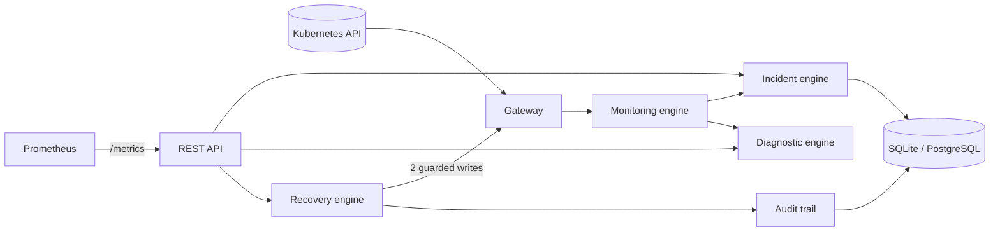

# KubiDoor

> KubiDoor is a lightweight Kubernetes operations tool for intelligent health monitoring, incident detection, root cause analysis, and safe automated recovery.

KubiDoor watches a cluster, turns failures into deduplicated incidents, explains them with deterministic,
evidence-based rules, and can (only when you explicitly allow it) perform two narrowly scoped recovery
actions, then **verifies** the result against the real cluster state. Everything is audited and exposed to
Prometheus.

**Safety first:** recovery is **disabled by default**, dry-run, approval-gated, namespace-allowlisted, rate
limited, and cooldown-protected. Monitoring is strictly read-only and never reads Secrets.

## Features

* **Monitoring** of Pods (CrashLoopBackOff, ImagePullBackOff/ErrImagePull, OOMKilled, Pending, Failed, Unknown,
  not-ready containers, excessive restarts), Nodes (NotReady, Memory/Disk/PID pressure, NetworkUnavailable),
  Deployments (unavailable replicas, ProgressDeadlineExceeded, ReplicaFailure) and PVCs (Pending, Lost), with
  configurable thresholds so scaling or young Pending pods do not page anyone.
* **Incident engine**: deterministic fingerprints, duplicate suppression, occurrence counting, acknowledge /
  resolve, auto-resolve on verified recovery, reopen on recurrence, filtering and pagination.
* **A Kubernetes API outage never resolves incidents** or reads as "healthy".
* **Root cause analysis**: rule-based, no LLM. Every result separates observed facts, probable cause,
  confidence (high/medium/low) and recommended actions; nothing is stated as confirmed without evidence.
* **Safe recovery**: `deployment_restart` and `pod_delete` only, UID-guarded, verified, audited, duplicate- and
  race-safe. See [docs/recovery-policy.md](docs/recovery-policy.md).
* **Observability**: `kubidoor_*` Prometheus metrics, ready-made Grafana dashboard, structured JSON logs with
  secret redaction, append-only audit trail.
* **REST API** (FastAPI, OpenAPI at `/docs`), SQLite by default, optional PostgreSQL.

## Architecture

See [docs/architecture.md](docs/architecture.md) for the full diagram and design notes.



## Technology stack

Python 3.12+, FastAPI, Pydantic v2, SQLAlchemy 2, Alembic, the official Kubernetes Python client,
prometheus-client, asyncio scheduler. Tooling: pytest, HTTPX/TestClient, Ruff, MyPy (strict). Infrastructure:
Docker, Docker Compose, Kubernetes manifests, Prometheus, Grafana, kind (demo).

## Requirements

* Python 3.12 or newer (developed and tested here on 3.13)
* Access to a Kubernetes cluster (kubeconfig, or run in-cluster) for real monitoring
* Optional: Docker, `kind`, `kubectl` for the demo; metrics-server for resource metrics

## Installation and local run

```bash
make install        # virtualenv + dev dependencies
make test           # unit + integration tests (no cluster needed)
make lint typecheck # ruff + mypy

make run            # uses your current kubeconfig context; API on http://127.0.0.1:8000/docs
# or choose a context explicitly:
KUBIDOOR_KUBERNETES__CONTEXT=kind-kubidoor make run
```

Other commands: `make docker-build`, `make demo-up`, `make demo-down`, `make e2e`, `make migrate`.
The database schema is migrated automatically at start (`KUBIDOOR_AUTO_MIGRATE=false` to disable).

## Configuration

All settings are environment variables prefixed `KUBIDOOR_` (nested: `__`; lists: JSON). Copy
[`.env.example`](.env.example). Highlights:

| Variable | Default | Meaning |
|---|---|---|
| `KUBIDOOR_DATABASE_URL` | `sqlite:///./kubidoor.db` | SQLite, or `postgresql+psycopg://...` |
| `KUBIDOOR_API_TOKEN` | unset | shared bearer token for `/api/v1/*` (blank = disabled) |
| `KUBIDOOR_MONITORING__INTERVAL_SECONDS` | `30` | monitoring cycle interval |
| `KUBIDOOR_MONITORING__NAMESPACES` | `[]` | restrict monitoring (empty = all) |
| `KUBIDOOR_MONITORING__PENDING_THRESHOLD_SECONDS` | `300` | Pending pod alert delay |
| `KUBIDOOR_RECOVERY__ENABLED` | `false` | master switch |
| `KUBIDOOR_RECOVERY__DRY_RUN` | `true` | describe, do not execute |
| `KUBIDOOR_RECOVERY__REQUIRE_APPROVAL` | `true` | human approval per action |
| `KUBIDOOR_RECOVERY__ALLOWED_NAMESPACES` | `["demo"]` | only these may be acted on |
| `KUBIDOOR_RECOVERY__BLOCKED_NAMESPACES` | `["kube-system"]` | never acted on (wins over allowed) |
| `KUBIDOOR_RECOVERY__COOLDOWN_SECONDS` | `300` | per-target cooldown |
| `KUBIDOOR_RECOVERY__MAX_ACTIONS_PER_HOUR` | `5` | global rate limit |

Settings are validated at startup; invalid values stop the process with a clear error.

## Local demo

> Docker Compose alone is **not** a Kubernetes cluster. The demo creates a real one with kind.

```bash
make demo-up      # kind cluster + 4 failure scenarios + KubiDoor, Prometheus, Grafana
# KubiDoor http://localhost:8000/docs   Prometheus :9090   Grafana :3000 (admin/admin)
make demo-down
```

Scenarios (CrashLoopBackOff, ImagePullBackOff, OOMKilled, unavailable Deployment) run only in the
`kubidoor-demo` namespace; cleanup touches nothing else. Details: [docs/demo-scenarios.md](docs/demo-scenarios.md).

## Kubernetes deployment

```bash
docker build -t kubidoor:latest .          # then load/push the image for your cluster
kubectl apply -k deploy/kubernetes         # namespace, read-only RBAC, config, Deployment, Service
kubectl -n kubidoor port-forward svc/kubidoor 8000:8000
```

The shipped config keeps recovery **off**. To enable recovery for specific namespaces also apply
`deploy/kubernetes/rbac-recovery.yaml` per namespace and change the ConfigMap deliberately.

### RBAC

Monitoring needs only `get`/`list` on nodes, pods, events, PVCs, deployments (and optionally
`metrics.k8s.io`). **No Secrets, no write verbs, no cluster-admin.** Recovery needs an extra, optional,
namespaced Role (`deployments: get,patch`, `pods: get,list,delete`). See [docs/rbac.md](docs/rbac.md).

## API examples

```bash
H='X-KubiDoor-Actor: alice'            # identity recorded in the audit trail
# add -H "Authorization: Bearer $KUBIDOOR_API_TOKEN" when a token is configured

curl -s localhost:8000/ready
curl -s localhost:8000/api/v1/cluster/overview
curl -s 'localhost:8000/api/v1/pods?namespace=demo&unhealthy_only=true'
curl -s 'localhost:8000/api/v1/incidents?severity=HIGH&status=OPEN&limit=20'
curl -s localhost:8000/api/v1/incidents/<incident_id>
curl -s -X POST -H "$H" localhost:8000/api/v1/incidents/<incident_id>/acknowledge -H 'content-type: application/json' -d '{"note":"looking"}'
curl -s -X POST -H "$H" localhost:8000/api/v1/incidents/<incident_id>/resolve

# on-demand diagnosis (use _ as namespace for nodes)
curl -s localhost:8000/api/v1/diagnostics/pod/demo/my-pod-abc12
curl -s localhost:8000/api/v1/diagnostics/node/_/worker-1

# recovery (only when enabled)
curl -s localhost:8000/api/v1/recovery/actions?status=PENDING_APPROVAL
curl -s -X POST -H "$H" localhost:8000/api/v1/recovery/actions/<action_id>/approve
curl -s -X POST -H "$H" localhost:8000/api/v1/recovery/actions/<action_id>/execute
curl -s -X POST -H "$H" localhost:8000/api/v1/recovery/actions/<action_id>/reject -H 'content-type: application/json' -d '{"reason":"too risky"}'
```

Endpoints: `GET /health`, `/ready`, `/metrics`; `GET /api/v1/cluster/overview|nodes|pods|deployments`;
`GET|POST /api/v1/incidents[...]`; `GET /api/v1/diagnostics/{type}/{namespace}/{name}`;
`GET|POST /api/v1/recovery/actions[...]` (list, request, get, approve, reject, execute).
Errors share one shape: `{"error": {"code", "message", "details"}}`; lists return
`{"items", "total", "limit", "offset"}`.

## Incident lifecycle

`OPEN -> ACKNOWLEDGED -> INVESTIGATING -> RESOLVED`, and `RESOLVED -> OPEN` when the problem returns.
See [docs/incident-lifecycle.md](docs/incident-lifecycle.md).

## Recovery safety model

Disabled, dry-run and approval-gated by default; only `deployment_restart` and `pod_delete`; one named,
UID-checked object per action; namespace allowlist plus blocklist (`kube-system` blocked); cooldown, hourly
rate limit and failure-loop prevention; policy re-checked at execution time; **verification of the resulting
cluster state** (an API 200 is not recovery); atomic claims so duplicate/concurrent requests execute once; every
step audited. See [docs/recovery-policy.md](docs/recovery-policy.md).

## Prometheus and Grafana

Metrics: `kubidoor_monitoring_cycles_total`, `kubidoor_monitoring_errors_total{stage}`,
`kubidoor_monitoring_cycle_duration_seconds`, `kubidoor_active_incidents{severity}`,
`kubidoor_incidents_detected_total{severity,resource_type}`, `kubidoor_recovery_actions_total{action_type,status}`,
`kubidoor_recovery_failures_total{action_type}`, `kubidoor_recovery_duration_seconds{action_type}`.
Labels are small fixed sets, never names, UIDs or ids.

Scrape config: [`deploy/prometheus/prometheus.yml`](deploy/prometheus/prometheus.yml). Dashboard:
[`deploy/grafana/dashboards/kubidoor-overview.json`](deploy/grafana/dashboards/kubidoor-overview.json)
(auto-provisioned by Compose; or import it manually with datasource uid `prometheus`). A test asserts every
metric the dashboard queries is really exposed.

## Testing

```bash
make test        # unit + integration; mocked/fake Kubernetes, never a real cluster, never destructive
make e2e         # optional, needs `make demo-up` (kind); deletes one demo pod after explicit approval
```

Coverage includes parsing, every detection rule, fingerprints, dedup/lifecycle/outage-safety, diagnostic rules,
every recovery policy rule, cooldown/rate-limit/loop prevention, dry-run, approvals, verification, concurrent
duplicate execution, API endpoints and error format, audit immutability, migrations-vs-models drift, metrics
and static checks of the RBAC/deploy manifests.

## Troubleshooting

See [docs/troubleshooting.md](docs/troubleshooting.md). Other docs: [monitoring](docs/monitoring.md).

## Known limitations

* **Not verified end to end in the development sandbox:** `docker build`, Docker Compose, the kind demo and the
  kind e2e test could not be run there (no Docker daemon / kind). They are written and statically tested; CI
  (`.github/workflows/ci.yml`) is configured to exercise them. Expect small first-run adjustments.
* Tested on Python 3.13 locally; 3.12 is the declared minimum and is in the CI matrix but was not run here.
* PostgreSQL support is untested against a live server (migration SQL renders correctly offline).
* Single instance only (in-process monitoring lock, SQLite). Running replicas would duplicate monitoring.
* Polling, not watch streams: detection latency is the monitoring interval.
* Resource metrics come from metrics-server only; Prometheus as a metrics source is not implemented.
* Actor identity is self-asserted (`X-KubiDoor-Actor`) and the requester may approve their own action.
* The audit trail is append-only at the application level, not at the database level.
* No Helm chart (optional in the spec); plain manifests with kustomize are provided.
* Recovery acts on Deployments and controller-managed Pods only; it never changes memory limits, images, or
  storage; those need a human.

## Security considerations

Without `KUBIDOOR_API_TOKEN` the API is unauthenticated: keep it on a trusted network. Do not widen RBAC;
leave `kube-system` blocked; review actions before approving; treat the optional write Role as production
access. See [docs/rbac.md](docs/rbac.md).

## License

MIT, see [LICENSE](LICENSE).
