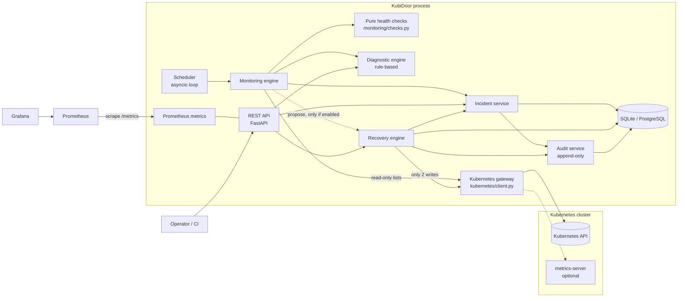
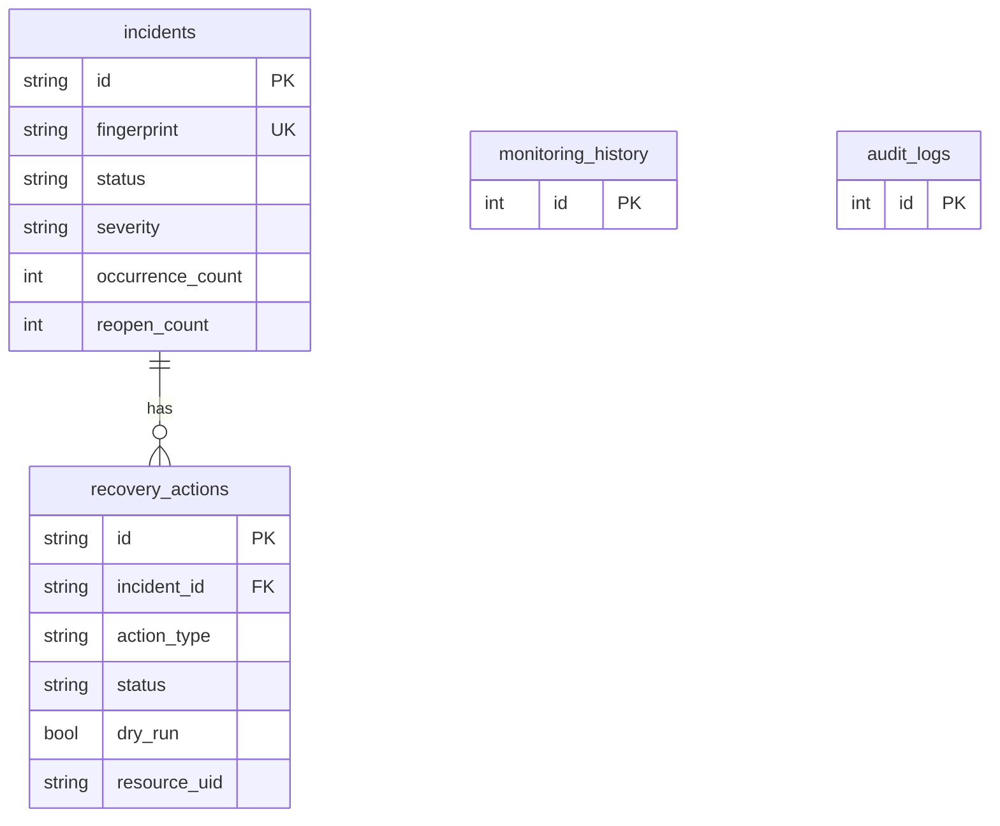

# Architecture

KubiDoor is a single Python process: a FastAPI app plus an in-process asyncio scheduler. Services are
wired by hand in one composition root (`kubidoor/container.py`); no global state, no framework magic.

## Layers and responsibilities

| Layer | Package | Responsibility |
|---|---|---|
| API | `api/` | HTTP, validation, pagination, error format. No business logic. |
| Kubernetes integration | `kubernetes/` | Parse API objects into plain dataclasses, translate errors, the only 2 writes. |
| Monitoring | `monitoring/` | Per-cycle inspection (`engine.py`), pure rules (`checks.py`), scheduling. |
| Incidents | `incidents/` | Fingerprints, dedup, lifecycle, queries. |
| Diagnostics | `diagnostics/` | Deterministic rules: facts vs probable cause vs confidence vs actions. |
| Recovery | `recovery/` | Policy (pure), actions, verification (pure judgments), orchestration. |
| Database | `database/` | SQLAlchemy models, UTC datetime type, sessions, migrations. |
| Metrics | `metrics/` | `kubidoor_*` Prometheus metrics. |
| Audit/logging | `audit/`, `logging/` | Append-only audit trail; JSON logs with secret redaction. |

## Design decisions

* **The gateway is a `Protocol`** (`KubeGateway`). Everything above it is tested against an in-memory fake;
  no unit test needs a cluster.
* **Checks and policies are pure functions** (no I/O, time injected). Every rule is unit-testable and
  deterministic.
* **Parsed domain objects, not raw API objects**, cross the gateway boundary. They carry no env vars or
  Secret data, so the REST API cannot leak them.
* **Time is injected** (`Clock`), so cooldowns, thresholds and verification are tested without sleeping.
* **Atomic state transitions** use `UPDATE ... WHERE status = <expected>`; exactly one concurrent caller
  wins (see [recovery-policy.md](recovery-policy.md)).
* **One process, one monitoring loop.** An in-process lock skips overlapping cycles. Running several
  replicas is not supported (see Known limitations in the README).

## Data model

`audit_logs` rows reference incidents/actions by id **without** a foreign key on purpose, so the audit
trail survives any future data pruning. All timestamps are timezone-aware UTC (naive datetimes are rejected).
