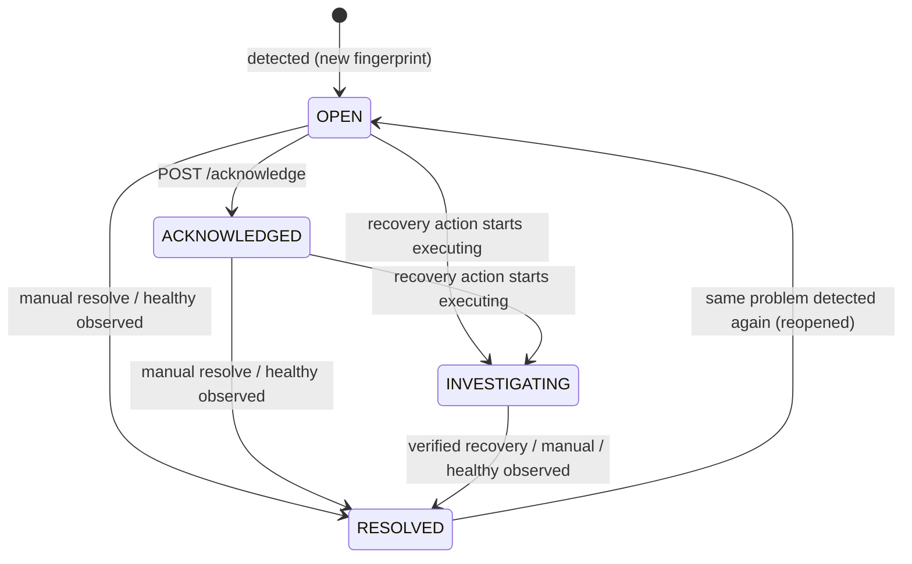

# Incident lifecycle

* **Created** when a finding has a fingerprint not seen before.
* **Deduplicated**: the fingerprint is `sha256(resource type, namespace, name, problem type, container)`.
  It is deterministic and has a UNIQUE database constraint, so repeated cycles (or concurrent writers) can
  only bump `occurrence_count` and `last_detected_at`. The resource **UID is deliberately not part of the
  fingerprint**: when a controller recreates a pod under the same name, the same problem continues the same
  incident instead of opening a duplicate (the new UID is stored on the incident).
* **Acknowledged**: records who and when. Idempotent (first acknowledger is kept). An acknowledged incident
  stays acknowledged while the problem persists.
* **INVESTIGATING**: set only when a real (non-dry-run) recovery execution starts. A mere proposal or a dry-run
  does not change the status, because nobody is acting yet.
* **Resolved** in three ways, all audited:
  1. manually (`POST /resolve`): if the problem is still there, the next cycle reopens it;
  2. automatically by monitoring, when a *successful* cycle that covered the resource sees it healthy or gone;
  3. automatically by recovery, only after the resulting cluster state is **verified**.
* **Reopened**: a resolved incident whose fingerprint is detected again goes back to OPEN (same row, history
  kept, `reopen_count` incremented, acknowledgement cleared).

## Correctness rules (each has tests)

1. Repeated cycles never create duplicate incidents.
2. A monitoring API failure never resolves incidents.
3. A temporary API outage is never read as "healthy".
4. Resolution is based on verified resource state.
5. Fingerprints are deterministic.

Every create/ack/resolve/reopen is written to `audit_logs` **in the same transaction** as the change.

## Querying

`GET /api/v1/incidents?severity=&status=&namespace=&resource_type=&limit=&offset=` returns a page
(`items`, `total`, `limit`, `offset`), newest detection first. `GET /api/v1/incidents/{id}` adds the audit
history and the recovery actions.
