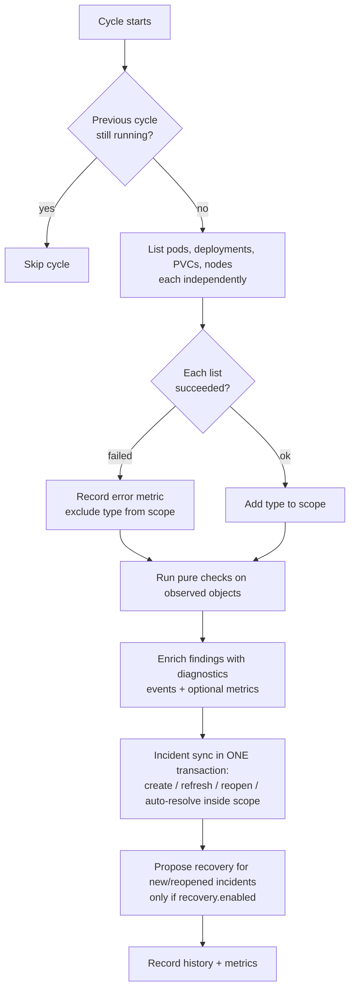

# Monitoring

The scheduler runs one cycle every `monitoring.interval_seconds` (default 30). A cycle is a pure
function of the cluster state it could observe.

## The safety rule that matters most

Each resource type is listed independently. A type whose listing **fails** (API outage, revoked RBAC,
timeout) is left out of the cycle's *scope*. Incidents are only auto-resolved for resources inside the
scope, so **an unreachable API never turns into "everything is healthy"**. An honest empty list from a
working API is a real observation and does resolve incidents. Both cases are covered by tests.

## Detection rules

| Resource | Problem (`problem_type`) | Detected when | Severity |
|---|---|---|---|
| Pod | `CrashLoopBackOff` | container waiting reason is CrashLoopBackOff | HIGH |
| Pod | `ImagePullBackOff` | waiting reason ImagePullBackOff / ErrImagePull | HIGH |
| Pod | `OOMKilled` | terminated (now, or within `recent_termination_seconds`) with reason OOMKilled | HIGH |
| Pod | `ContainerCreateError` | CreateContainerConfigError, InvalidImageName, ... | MEDIUM |
| Pod | `PodPending` | Pending longer than `pending_threshold_seconds` and not already explained by a container finding | MEDIUM |
| Pod | `PodFailed` / `PodUnknown` | phase Failed / Unknown | HIGH |
| Pod | `ContainersNotReady` | Running, not Ready for longer than `not_ready_threshold_seconds` | MEDIUM |
| Pod | `ExcessiveRestarts` | restarts >= `restart_threshold` and last termination recent | MEDIUM |
| Node | `NodeNotReady` | Ready condition is not `True` | CRITICAL |
| Node | `NodeMemoryPressure`, `NodeDiskPressure`, `NodePIDPressure`, `NodeNetworkUnavailable` | condition `True` | HIGH |
| Deployment | `ProgressDeadlineExceeded` | Progressing=False, reason ProgressDeadlineExceeded | HIGH |
| Deployment | `ReplicaFailure` | ReplicaFailure condition True | HIGH |
| Deployment | `ReplicasUnavailable` | available < desired **and** no progress for `deployment_grace_seconds` | HIGH if 0 available, else MEDIUM |
| PVC | `PVCPending` | Pending beyond `pvc_pending_threshold_seconds` (not `WaitForFirstConsumer`) | MEDIUM |
| PVC | `PVCLost` | phase Lost | HIGH |

Deliberate non-alerts: Succeeded and terminating pods, paused or scaled-to-zero Deployments, young Pending
pods, a Deployment that is simply scaling inside its grace period, PVCs waiting for their first consumer.
When a container is OOMKilled, the redundant CrashLoopBackOff for that container is suppressed (one root
cause, one incident). Each failing container gets its own incident.

## Evidence collected per pod finding

Namespace, pod name and UID, container, state and reason, restart count, creation time, node, termination
reason and exit code, and the relevant events. Node findings carry conditions, capacity, allocatable and
last-transition times.

## Resource metrics (optional)

`metrics.k8s.io` (metrics-server) is queried only when an OOMKilled finding or an on-demand diagnosis can use
it. If it is unavailable the diagnosis says so ("Usage metrics unavailable: ...") and `/api/v1/cluster/overview`
reports `resource_metrics.available=false`. **Values are never estimated or invented.**

## Thresholds

All thresholds are in `.env.example` and `core/config.py`. On-demand diagnostics
(`GET /api/v1/diagnostics/...`) ignore the time-based alerting thresholds: if something is wrong right now,
it is explained even if it is "too young to alert".
