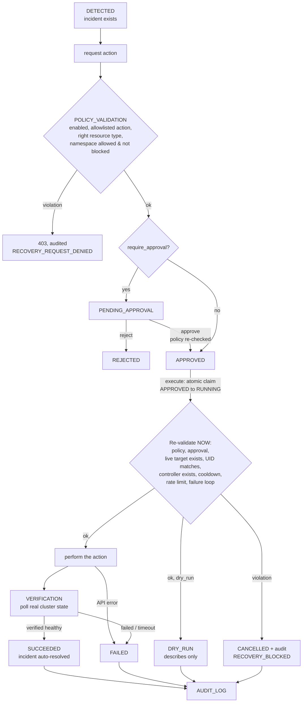

# Recovery policy and safety model

Recovery is the only part of KubiDoor that can change a cluster, so it is **off by default** and surrounded
by independent safeguards.

## Defaults

```yaml
recovery:
  enabled: false            # nothing can run
  dry_run: true             # even when enabled, actions are only described
  require_approval: true    # a human must approve every action
  allowed_namespaces: [demo]
  blocked_namespaces: [kube-system]
  allowed_actions: [deployment_restart, pod_delete]
  cooldown_seconds: 300
  max_actions_per_hour: 5
  verify_after_action: true
  max_consecutive_failures: 3   # loop prevention (extension to the base spec)
```

Configure with `KUBIDOOR_RECOVERY__...` variables (see `.env.example`). To really execute you must
deliberately set `ENABLED=true`, `DRY_RUN=false`, add namespaces to `ALLOWED_NAMESPACES`, **and** apply the
optional write RBAC ([rbac.md](rbac.md)). Missing any one of these keeps the cluster untouched.

## What can ever be done

Exactly two mutations exist in the code (`recovery/actions.py`, `kubernetes/client.py`):

| Action | Target | Implementation |
|---|---|---|
| `deployment_restart` | one Deployment | patch the pod-template `restartedAt` annotation (same as `kubectl rollout restart`) after re-reading the Deployment and comparing its UID |
| `pod_delete` | one Pod | delete by name with a **UID precondition**; the API server rejects it if the UID differs |

"Check rollout status" and "read-only diagnostics" are the verification step and `GET /api/v1/diagnostics/...`.
There is no shell execution, no generic "run command", no action type for Nodes, PersistentVolumes,
PersistentVolumeClaims, Secrets, RBAC, or resource limits. A test asserts the action enum contains only
those two values and that neither can target Nodes or PVCs. Actions apply to **one named object**, never a
whole namespace.

## Workflow



States: `PENDING_APPROVAL, APPROVED, REJECTED, DRY_RUN, RUNNING, SUCCEEDED, FAILED, CANCELLED`.
Every transition is persisted, audited, and counted in `kubidoor_recovery_actions_total{action_type,status}`.

## The checks

| Check | When | Notes |
|---|---|---|
| Globally enabled | request, approve, execute | flipping `enabled=false` after approval cancels the action |
| Action allowlisted | request, approve, execute | |
| Action appropriate for the resource | request, approve, execute | `pod_delete` only Pods, `deployment_restart` only Deployments |
| Namespace allowed **and** not blocked | request, approve, execute | an empty allowlist permits nothing; `blocked` wins over `allowed`; `kube-system` is blocked by default |
| Resource exists, UID matches | execute (and again by the API server / client) | a pod replaced under the same name is refused |
| Pod has a recreating controller | execute | ReplicaSet/StatefulSet/DaemonSet/Job; a bare pod would be destroyed, not healed |
| Deployment not paused / not scaled to zero | execute | |
| Approval exists (when required) | execute | |
| Cooldown | execute | per target (type+namespace+name); counts only *real* executions; dry-runs and cancelled actions never consume it |
| Rate limit | execute | `max_actions_per_hour` across all targets, real executions only |
| Failure-loop prevention | execute | after `max_consecutive_failures` consecutive FAILED actions on a target, further attempts are cancelled until investigated |
| Dry-run | execute | an action created as real is downgraded to dry-run if the operator sets `dry_run=true` before it runs; the setting can only *tighten* |

A `CANCELLED` action explains why in `error_message`; to try again, request a new one.

## Verification: an API 200 is not recovery

After the call, KubiDoor polls the **resulting cluster state** (every `verification_poll_seconds`, up to
`verification_timeout_seconds`):

* `deployment_restart` succeeds only when the controller has observed the new generation **and**
  updated = ready = available = desired replicas with none unavailable. `ProgressDeadlineExceeded`, a
  vanished or replaced Deployment is a failure.
* `pod_delete` succeeds only when the original UID is gone **and** a replacement pod owned by the same
  controller is Running and Ready.

On success the incident is auto-resolved. On failure or timeout the action is `FAILED`, the incident is
**preserved** (not resolved), and `kubidoor_recovery_failures_total` increments. Deleting a crash-looping pod
therefore ends `FAILED` by design: the replacement crashes too. Transient API errors during verification are
retried until the timeout.

If KubiDoor stops while an action is `RUNNING`, the next start marks it `FAILED` ("outcome unknown") so
nothing is stuck. Shutdown waits for in-flight verifications before closing the database.

## Race conditions and duplicate execution

Approve, reject and the *execution claim* are single `UPDATE ... WHERE status = <expected>` statements; the
database lets exactly one concurrent caller win and everyone else receives `409 Conflict`. Terminal
transitions only apply to a `RUNNING` row, so they are idempotent. Requesting the same action while one is
still pending/approved/running returns the existing one. Tests run 8 concurrent executes and 6 concurrent
approvals against SQLite files and assert a single winner and a single cluster call.

## Automatic proposals

When recovery is enabled the monitor proposes (never executes, unless `require_approval=false` **and**
`dry_run=false`) for new or reopened incidents of these types only:

| Problem | Proposed action |
|---|---|
| CrashLoopBackOff, PodFailed, PodUnknown | `pod_delete` |
| ReplicasUnavailable, ProgressDeadlineExceeded | `deployment_restart` |

OOMKilled, ImagePullBackOff, Pending, node and storage problems get **no** proposal: a restart does not fix a
too-small memory limit, a wrong image or a full disk, and KubiDoor never changes limits automatically.

## Approver identity

The actor comes from the `X-KubiDoor-Actor` header and is **self-asserted**; the same person may request and
approve. Set `KUBIDOOR_API_TOKEN` and/or put the API behind your own authenticating proxy if you need real
identity or separation of duties.
